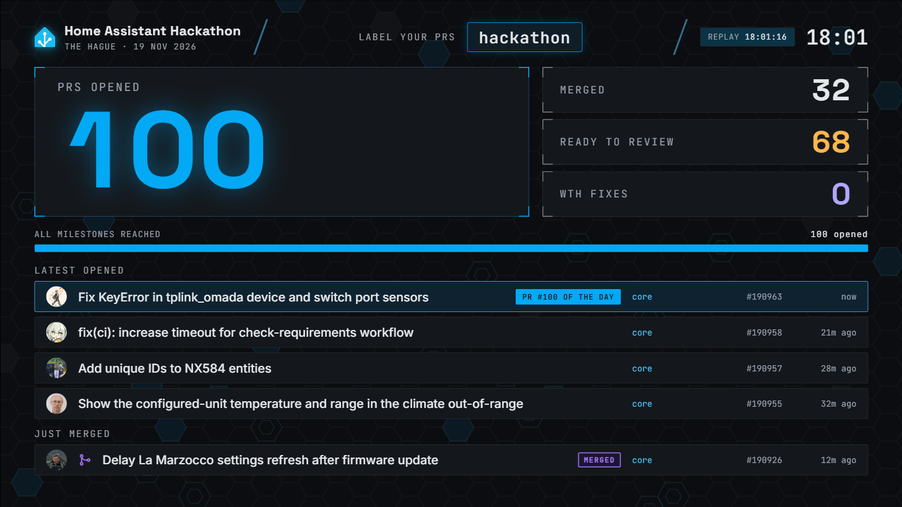

# Home Assistant hackathon PR dashboard

A live dashboard for a screen at the hackathon. It counts PRs opened and merged during the day (identified by a label), shows the latest ones, and celebrates milestones.



## Requirements

- Python 3.11 or newer. Nothing to install, it only uses the standard library.
- A browser (Firefox or Chromium).

## Setup

1. Clone this repo.
2. Create `github_token.txt` in the project folder containing a GitHub token (just the token, one line). Git ignores this file.
   - GitHub: Settings → Developer settings → Personal access tokens → **Fine-grained tokens** → Generate new token.
   - Repository access: **Public repositories**. Permissions: none needed.
   - Without a token it still works, with a lower rate limit.
3. Check the settings at the top of `dashboard.py`.

## Settings

At the top of `dashboard.py`:

| Setting | What it does |
|---|---|
| `HACKATHON_LABEL` | Label people add to their PRs. `""` means every PR (for testing) |
| `START_TIME` | PRs created before this are ignored. Change this for the next hackathon |
| `ORGS` | GitHub org(s) to search |
| `EVENT_LOCATION` | Shown in the header, with the date taken from `START_TIME` |
| `WTH_LABEL` | Label for WTH fixes |
| `MILESTONES` | PR counts that trigger a celebration |
| `DEMO_MODE` | `True` makes plain `python dashboard.py` run the demo |

## Running

```
python dashboard.py
```

Open http://localhost:8080 and press F11 for full screen. The terminal also prints an address for other devices on the same network. Stop with Ctrl+C.

The dashboard checks GitHub every 20 seconds (`POLL_SECONDS`). If GitHub can't be reached it keeps the last numbers and recovers by itself.

### Effects

If the dashboard stutters on a slow machine, open it with `?lite` to turn off the heaviest effects (the hexagon ripples and shockwave rings). Everything else still plays:

```
http://localhost:8080/?lite
```

The full effects run smoothly on a Pi 5 at 1080p. 4K hasn't been tested on the Pi yet, so 1080p output is the safe choice.

### Demo and replay

```
python dashboard.py import-sample                  # copy 100 recent real PRs into data/sample.db
python dashboard.py demo                           # replay them in 3 minutes
python dashboard.py demo --duration 20m            # slower, closer to the real pace
python dashboard.py replay data/<file>.db --speed 60   # replay a real day at 60x, e.g. for a timelapse
```

A replay starts when the command starts, so restart the command (and refresh the page) to watch it again.

### Tests

```
python -m unittest discover -s tests
```

## On the day

- Run it on the Pi (or the laptop as a backup) and open it in the browser on that machine, full screen.
- Set the Pi's screen output to 1080p, even on a 4K screen.
- Check the Pi's clock is right once it's online.
- If it stutters, try `?lite`.

## Data

Everything is stored in SQLite under `data/`. The live database is named after the label and date, e.g. `data/live-hackathon-2026-11-19.db`, so test runs never affect the real day.

Example queries for stats afterwards:

```sql
-- PRs per repo
SELECT repo, COUNT(*) FROM prs WHERE still_labelled = 1 GROUP BY repo ORDER BY 2 DESC;

-- PRs per person
SELECT author, COUNT(*) FROM prs WHERE still_labelled = 1 GROUP BY author ORDER BY 2 DESC;

-- WTH fixes opened and merged
SELECT COUNT(*), COUNT(merged_at) FROM prs WHERE still_labelled = 1 AND labels LIKE '%"WTH"%';
```
